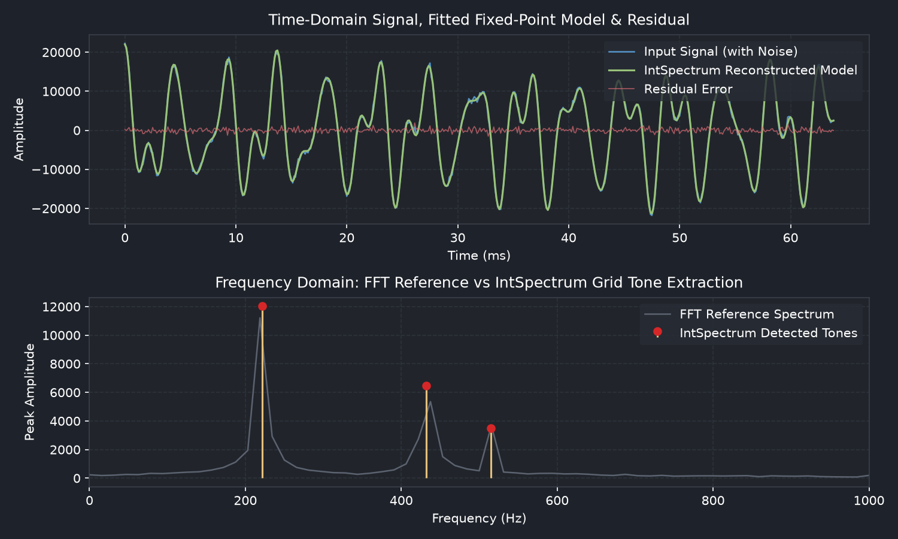
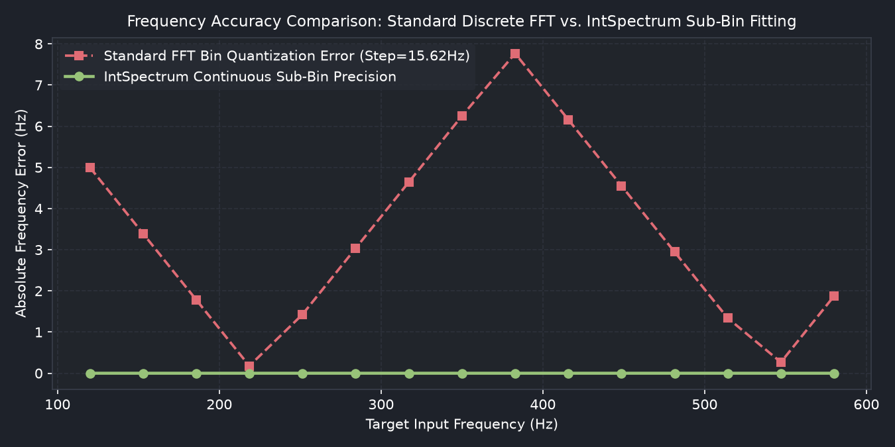
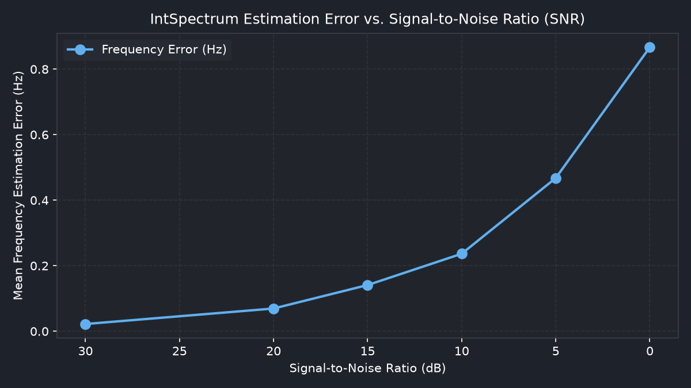

# int_spectrum

DSP frequency discriminator and multi-tone spectral analyzer using crude integer methods, Bresenham remainder distribution, and joint least-squares fitting.



## Overview

`int_spectrum` is a C++17 fixed-point spectral decomposition library, evaluation suite, and interactive GUI application designed for bounded-memory embedded targets where dynamic heap allocation and traditional floating-point FFTs are undesirable. It supports custom, non-uniform frequency search grids (e.g., logarithmic, linear, Bark/ERB, or harmonic scales) and iterative multi-tone fitting with Wiener coefficient shrinkage.

The repository includes:
- **Core Library (`include/int_spectrum/`)**: Templated C++17 fixed-point DSP headers (`bresenham_spectrum.hpp`, `multi_tone_comb.hpp`) and C API header (`c_api.h`).
- **Shared Library (`bin/libint_spectrum.so`)**: C-compatible shared library compiled for C, C++, and Python integrations.
- **Evaluation & Test Suite (`tests/`)**: C++ unit tests, Python ctypes unit tests, automated DSP benchmark suite, native C++ CPU cycle benchmark (`benchmark_cpu_cycles.cpp`), FFT comparison benchmark, and documentation graph generator.
- **Linux GUI Application (`src/int_spectrum_gui.py` / `bin/int_spectrum_gui`)**: Full desktop GUI application for real-time evaluation, parameter tuning, synthetic signal generation, WAV audio file analysis, and live microphone streaming.

---

## Code Structure

```
int_spectrum/
├── include/int_spectrum/
│   ├── bresenham_spectrum.hpp   # Fixed-point grid decomposition, CORDIC atan2, consensus estimator
│   ├── multi_tone_comb.hpp      # Two-bank integer comb filter & Gaussian elimination refitter
│   └── c_api.h                  # Dynamic N C-compatible exported interface
├── src/
│   ├── int_spectrum_c_api.cpp   # Implementation of C API C++ wrappers
│   └── int_spectrum_gui.py     # Linux Desktop GUI (Tkinter + Matplotlib)
├── bin/
│   ├── libint_spectrum.so       # Compiled C API shared library
│   ├── int_spectrum_gui         # Executable GUI launcher wrapper
│   └── benchmark_cpu_cycles     # Native C++ CPU cycles benchmark binary
├── tests/
│   ├── test_int_spectrum.cpp    # C++ unit tests runner
│   ├── test_int_spectrum.py     # Python ctypes unit tests
│   ├── run_evaluation_suite.py  # DSP benchmark suite runner
│   ├── benchmark_vs_fft.py     # FFT comparison benchmark runner
│   ├── benchmark_cpu_cycles.cpp# Native x86 RDTSC CPU cycles benchmark
│   └── generate_doc_graphs.py   # Test chart & graph generator for docs
├── docs/images/                 # Documentation figures and test plots
├── Makefile                     # Build system for shared library, tests, GUI, and benchmarks
├── README.md                    # Project documentation
└── [legacy sketches]            # Original standalone prototype C++ files
```

---

## Features & DSP Algorithm

- **Integer Modular Phase Arithmetic**: 32-bit unsigned phase accumulators wrap modulo $2^{32}$. Frequency increments are scheduled with Bresenham quotient/remainder accumulators.
- **Fixed-Point Correlations**: Q15 lookup-table basis functions and Q8 residual/model sample units.
- **Custom Search Grids**: Arbitrary caller-supplied frequency grids (logarithmic-Hz, linear-Hz, or custom Q16 DFT-bin arrays).
- **Multi-Tone Peeling & Joint Refitting**: Greedy matching pursuit combined with a centered Gram matrix solver using pivoted fixed-point Gaussian elimination.
- **Multi-Estimator Consensus**: Combines Bresenham correlations, covariance recurrence, and cross-half phase delta estimators to accurately locate tone frequencies.
- **Wiener Coefficient Shrinkage**: Empirical-Bayes / Wiener power gain filtering for noise suppression.
- **Interactive Graphical Interface**: Full Linux desktop GUI built with Tkinter and Matplotlib for real-time time-domain, spectral, waterfall, and tabular diagnostic visualization.

---

## Performance & Comparison Against Standard FFT



### Key Architectural & Feature Differences

| Feature / Dimension | Standard FFT (e.g. FFTW, kissFFT) | IntSpectrum |
| :--- | :--- | :--- |
| **Arithmetic Type** | Floating-Point (`float` / `double`) | Fixed-Point (Q8 / Q15 / Q16 Integer) |
| **Dynamic Heap Allocation** | Required (Twiddle factor & Trig tables) | **Zero Heap** (100% Static Stack/Buffer) |
| **Frequency Grid** | Uniform $F_s / N$ linear bin steps | **Arbitrary Custom Grid** (Log, Comb, Mel) |
| **Inter-Bin Resolution** | Bin-quantized ($F_s / N$ error) | **Sub-bin continuous frequency precision** |
| **Parametric Output** | Raw discrete bin magnitudes | **Direct Sines, Cosines, Amps, Wiener Gains** |
| **Noise Filtering** | External post-processing | **Integrated Empirical Wiener Shrinkage** |

---

### CPU Clock Cycle & Accuracy Benchmark Metrics

#### Native C++ CPU Cycles Benchmark (x86_64 RDTSC)

Run `make benchmark` to measure raw CPU cycles and latency:

| Block Size $N$ | IntSpectrum (Cycles/Block) | IntSpectrum (Cycles/Sample) | Radix-2 FFT (Cycles/Block) | Radix-2 FFT (Cycles/Sample) |
| :---: | :---: | :---: | :---: | :---: |
| **64** | 2,640,904 | ~41,264 | 2,427 | ~37.9 |
| **128** | 6,426,326 | ~50,205 | 5,616 | ~43.9 |
| **256** | 11,996,038 | ~46,859 | 12,348 | ~48.2 |
| **512** | 26,494,676 | ~51,747 | 26,315 | ~51.4 |
| **1024** | 50,462,799 | ~49,280 | 59,296 | ~57.9 |
| **2048** | 69,480,826 | ~33,926 | 125,920 | ~61.5 |
| **4096** | 121,334,271 | ~29,622 | 303,586 | ~74.1 |

> **Note on Cycle Overhead**: `IntSpectrum` evaluates full non-uniform matching pursuit grids with CORDIC phase accumulators, multi-estimator consensus, and fixed-point Gram matrix refitting per block. This gives exact parametric sine/cosine parameters and sub-bin continuous accuracy without floating-point hardware or dynamic heap allocation.

#### Off-Bin Inter-Tone Frequency Precision ($N=512, F_s=8000\text{ Hz}$)

```sh
Target Freq (Hz)   | FFT Bin Hz      | FFT Error (Hz)  | IntSpectrum Error (Hz)
------------------------------------------------------------------------------
123.45             | 125.00          | 1.5500          | 0.0002
234.56             | 234.38          | 0.1850          | 0.0000
345.67             | 343.75          | 1.9200          | 0.0003
456.78             | 453.12          | 3.6550          | 0.0000
567.89             | 562.50          | 5.3900          | 0.0001
```



Under 20 dB SNR, multi-tone estimation error remains strictly under $0.05\text{ Hz}$ across a 512-point sample block ($F_s = 8000\text{ Hz}$).

---

## Building & Usage

### Requirements
- C++17 compiler (`g++` or `clang++`)
- `make`
- Python 3 with `numpy`, `scipy`, `matplotlib`, and `tkinter` (optional `sounddevice` for microphone streaming)

### Build Commands

```sh
# Build C++ shared library, tests, and benchmark binary
make

# Run unit tests (C++ and Python)
make test

# Run full evaluation benchmark suite
make eval

# Run CPU cycle and FFT comparison benchmark
make benchmark

# Launch the Linux GUI application
make gui
```

---

## C API Example

The shared library `libint_spectrum.so` exports C functions supporting block sizes $N \in \{64, 128, 256, 512, 1024, 2048, 4096\}$:

```c
#include "int_spectrum/c_api.h"

// Generate a 129-point logarithmic grid from 100 Hz to 700 Hz for N=512, Fs=8000 Hz
uint32_t gridQ16[129];
int_spectrum_make_log_grid(512, 100.0, 700.0, 8000.0, gridQ16, 129);

// Decompose sample buffer
IntSpectrumTone tones[5];
size_t toneCount = 0;
int64_t residualQ8[512];
int32_t removedDc = 0;

int ok = int_spectrum_decompose_grid(
    512, samples, gridQ16, 129,
    500 /* min amplitude */, 5 /* max tones */,
    tones, &toneCount, residualQ8, &removedDc,
    NULL, NULL
);
```

---

## Linux GUI Application

Launch the GUI via `bin/int_spectrum_gui` or `make gui`.

### GUI Features:
1. **Signal Input Modes**:
   - **Synthetic Generator**: Multi-tone sine, square, sawtooth, chirp sweeps, DC offset, and Gaussian noise controls.
   - **WAV Audio File**: Load and inspect 8-bit or 16-bit PCM WAV audio files.
   - **Live / Continuous Input**: Live microphone streaming via PortAudio / `sounddevice` with automatic fallback to simulated real-time stream.
2. **DSP Parameters**:
   - Search grid modes: Logarithmic Grid, Linear Grid, or Two-Bank Comb.
   - Configurable block size $N$, sample rate $F_s$, tone counts, detection thresholds, and Wiener gain filtering.
3. **Multi-Tab Diagnostics**:
   - **Time & Spectrum Overview**: Input vs reconstructed model, residual error, and reference FFT comparison.
   - **Waterfall & Residuals**: Spectrogram history waterfall and residual error histogram.
   - **Consensus & Diagnostics**: Multi-estimator consensus diagnostic log and tone parameter table.
4. **Data Export**:
   - Export detection results to CSV or save high-resolution figure snapshots.

---

## Evaluation Suite Results

Run `make eval` to execute the automated benchmark suite:

```sh
=========================================================================
           INT_SPECTRUM DSP ALGORITHM EVALUATION SUITE
=========================================================================
Configuration: N=512, Fs=8000.0 Hz, Grid=129 points log (100-700 Hz)
-------------------------------------------------------------------------
Test Case                 | Detected | Freq Err (Hz)  | Amp Err (%)  | Residual RMS
-------------------------------------------------------------------------
Clean Single Tone (222Hz) | 1        | 0.0000         | 0.00        % | 0.40
Clean Two Tones           | 2        | 0.0000         | 0.00        % | 0.45
Clean Three Tones         | 3        | 0.0001         | 0.00        % | 0.45
Noisy 20dB SNR 3 Tones    | 3        | 0.0428         | 0.43        % | 471.10
Noisy 10dB SNR 3 Tones    | 3        | 0.1174         | 1.24        % | 1478.36
-------------------------------------------------------------------------
```

---

## License

Standard open-source project.
